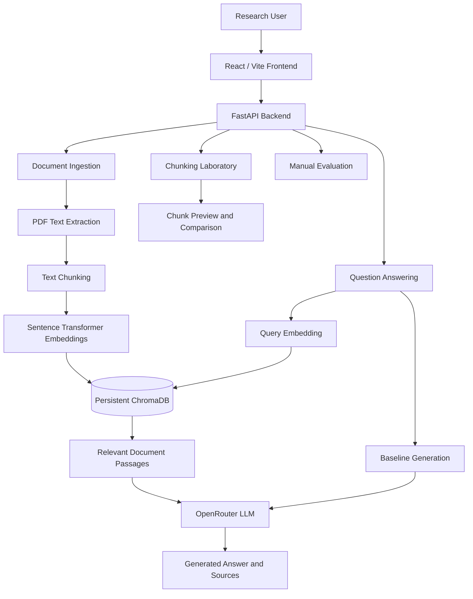
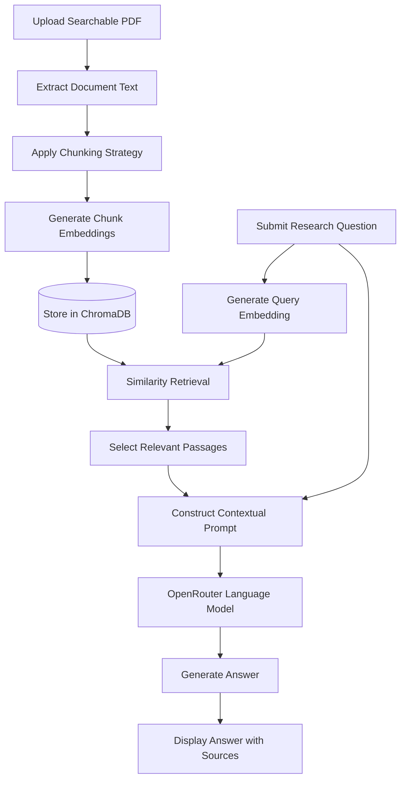
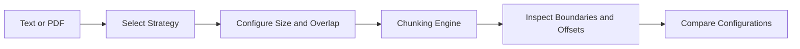

# MediRAG AI v2
### Clinical Guideline Research Using Retrieval-Augmented Generation

[](https://www.python.org/)
[](https://fastapi.tiangolo.com/)
[](https://react.dev/)
[](https://www.trychroma.com/)
[](https://openrouter.ai/)
[](#system-architecture)
[](#project-status)

---

## Overview

**MediRAG AI v2** is a full-stack, Retrieval-Augmented Generation (RAG) application developed for educational research involving clinical guidelines and medical literature.

The platform enables users to upload text-searchable PDF documents, transform their contents into vector embeddings, retrieve relevant passages through semantic similarity search, and generate context-aware answers using Large Language Models (LLMs).

Unlike conventional LLM-based question-answering systems, MediRAG AI incorporates document retrieval to provide supporting evidence from uploaded guidelines. It also offers a baseline comparison mode, an interactive chunking laboratory, and a manual evaluation interface.

The system integrates **FastAPI, React, Vite, Sentence Transformers, ChromaDB, and OpenRouter** within a locally hosted development environment.

> **Research disclaimer:** This software is intended exclusively for education, experimentation, and clinical guideline research. It is not a medical device, clinical decision support system, or substitute for qualified healthcare professionals.

## Table of Contents

1. [Project Objectives](#project-objectives)
2. [Core Features](#core-features)
3. [Technology Stack](#technology-stack)
4. [System Architecture](#system-architecture)
5. [RAG Processing Workflow](#rag-processing-workflow)
6. [Installation and Configuration](#installation-and-configuration)
7. [Application Usage](#application-usage)
8. [Chunking Laboratory](#chunking-laboratory)
9. [API Reference](#api-reference)
10. [RAG and Baseline Comparison](#rag-and-baseline-comparison)
11. [Troubleshooting](#troubleshooting)
12. [Security and Privacy](#security-and-privacy)
13. [Limitations](#limitations)
14. [Future Development](#future-development)
15. [Project Status](#project-status)

---

## Project Objectives

The primary objective of MediRAG AI is to investigate how retrieval-augmented language models can support evidence-oriented exploration of clinical guideline documents.

The project focuses on:

- Developing a document-grounded question-answering pipeline.
- Implementing local embedding generation and persistent vector storage.
- Investigating semantic similarity retrieval for clinical documents.
- Comparing retrieval-augmented responses against non-retrieval LLM responses.
- Experimenting with text chunking strategies and overlapping context windows.
- Supporting manual assessment of answer relevance, evidence grounding, and completeness.
- Providing a modular full-stack environment for further RAG research.

## Core Features

| Component | Functionality |
|---|---|
| Document Knowledge Base | Upload, process, and index searchable PDF guidelines |
| Text Extraction | Extract machine-readable text from PDFs |
| Chunking Engine | Fixed-size and heuristic structure-aware segmentation |
| Embedding Generation | Generate local embeddings using Sentence Transformers |
| Vector Storage | Persist document vectors in ChromaDB |
| Semantic Retrieval | Retrieve relevant passages using vector similarity |
| LLM Integration | Generate answers through OpenRouter |
| Source Attribution | Display supporting retrieved document sources |
| Baseline Comparison | Compare RAG answers with non-retrieval LLM answers |
| Chunking Lab | Preview chunks and compare six configurations |
| Evaluation Interface | Manually review generated answers |
| REST API | FastAPI endpoints with interactive Swagger documentation |

### Document Knowledge Base

The knowledge base provides document ingestion and indexing capabilities. Users can upload searchable PDF documents, configure chunking parameters, and select indexed documents for question answering.

Re-uploading an existing PDF triggers re-indexing using the newly selected chunking settings.

### Document-Grounded Question Answering

The question-answering pipeline retrieves relevant document passages before generating an answer. Retrieved passages are supplied as context to the configured OpenRouter LLM.

Supporting sources are presented for user inspection and verification.

### Comparative Response Analysis

The platform supports two response-generation approaches: RAG-based generation with retrieved context and baseline generation without retrieved context.

This enables users to investigate the effects of retrieval on response quality.

### Chunking Experimentation

The Chunking Lab provides direct visibility into how documents are segmented, including chunk boundaries, overlap regions, character offsets, and segmentation reasons.

---

## Technology Stack

| Category | Technology | Responsibility |
|---|---|---|
| Frontend | React | Interactive user interface |
| Build Tool | Vite | Frontend development and API proxy |
| Backend | FastAPI | REST API and application logic |
| Programming Language | Python | Document processing and AI pipeline |
| Embeddings | Sentence Transformers | Local vector representation |
| Vector Database | ChromaDB | Persistent embedding storage and retrieval |
| LLM Gateway | OpenRouter | Access to configured language models |
| API Documentation | OpenAPI / Swagger | Endpoint exploration and testing |
| Development Environment | Windows / PowerShell | Local execution |

## System Architecture

The architecture separates the user interface, backend application, document ingestion pipeline, vector database, and external LLM inference service.



### Architectural Design

**Frontend Layer**

The React interface provides document management, question submission, response comparison, chunking experimentation, and evaluation views.

**Backend Layer**

FastAPI handles API requests, document processing, retrieval operations, and LLM integration.

**Embedding Layer**

Sentence Transformers generate numerical vector representations locally.

**Storage Layer**

ChromaDB stores indexed embeddings persistently and supports similarity retrieval.

**Generation Layer**

OpenRouter provides access to the selected LLM. Inference requires a valid API key and access to the configured model.

## RAG Processing Workflow



### Pipeline Explanation

**1. Document Ingestion**

A searchable PDF is uploaded and its machine-readable content is extracted.

**2. Text Segmentation**

The extracted content is divided into chunks according to the selected segmentation strategy, chunk size, and overlap.

**3. Embedding Generation**

Each text chunk is transformed into a numerical vector using a local Sentence Transformers model.

**4. Vector Indexing**

Generated embeddings are persisted in ChromaDB for subsequent retrieval.

**5. Query Embedding**

The research question is converted into a vector representation.

**6. Similarity Retrieval**

ChromaDB identifies document chunks that are semantically similar to the question.

**7. Context Construction**

Retrieved passages are incorporated into the prompt supplied to the language model.

**8. Answer Generation**

The configured OpenRouter model generates a response using the provided context.

**9. Source Verification**

The application presents the generated answer alongside supporting retrieved sources, allowing the user to inspect the evidence.

---

## Installation and Configuration

### Prerequisites

Install or obtain the following before starting the application:

| Requirement | Purpose |
|---|---|
| Python 3 | Backend runtime |
| pip | Python dependency installation |
| Node.js and npm | Frontend development |
| Internet connection | Initial installation, model download, and LLM API access |
| OpenRouter account | Language model access |
| OpenRouter API key | Authentication |
| Searchable PDF | Document ingestion |

The exact supported Python and Node.js versions should be checked against the project's dependency configuration.

### 1. Download the Project

Download and extract the project archive.

Open the extracted `MediRAG_AI_v2` directory.

### 2. Configure Environment Variables

Copy `.env.example` to `.env` in the project root.

```env
OPENROUTER_API_KEY=your_openrouter_api_key
OPENROUTER_MODEL=your_enabled_model_id
```

Replace the placeholders with your valid OpenRouter credentials and model identifier.

**Important:** The `.env` file belongs in the project root, not in the `backend` or `frontend` directory.

### 3. Start the Backend

For Windows, run:

```text
START_BACKEND.bat
```

Wait for:

```text
Uvicorn running on http://127.0.0.1:8000
```

The first startup may take additional time because dependencies and the embedding model may need to be downloaded.

### 4. Verify the Backend

Open:

http://127.0.0.1:8000/api/health

A healthy backend should return a response indicating:

```json
{
  "status": "ok"
}
```

### 5. Start the Frontend

Run:

```text
START_FRONTEND.bat
```

Open:

http://127.0.0.1:5173

Both the backend and frontend must remain running during application use.

### Manual Backend Setup

Open PowerShell in the project root.

```powershell
cd backend
py -3 -m venv .venv
.venv\Scripts\Activate.ps1
python -m pip install -r requirements.txt
python -m uvicorn app.main:app --reload --port 8000
```

### Manual Frontend Setup

Open a separate terminal in the project root.

```powershell
cd frontend
npm install
npm run dev
```

If PowerShell prevents virtual environment activation, review its execution policy or invoke the virtual environment's Python executable directly.

---

## Application Usage

### Knowledge Base

1. Open the Knowledge Base page.
2. Upload a text-searchable PDF document.
3. Configure the chunking strategy, size, and overlap.
4. Allow document processing and indexing to complete.
5. Select the indexed document.
6. Submit a research question.
7. Review the generated answer and its supporting sources.

### Response Comparison

Use comparison mode to request both a retrieval-augmented answer and a baseline answer without retrieved context.

Examine differences in evidence grounding, relevance, and completeness.

### Evaluation

Use the evaluation page to manually review responses and record research observations through the available interface.

---

## Chunking Laboratory

The Chunking Lab supports controlled experimentation with document segmentation.

### Available Strategies

| Strategy | Description |
|---|---|
| `fixed` | Divides text into character-based windows |
| `structure` | Uses heuristic headings, paragraphs, sentences, and word boundaries |

Structure-aware chunking is not embedding-based semantic segmentation.

### Configuration Parameters

| Parameter | Supported Range |
|---|---|
| Chunk Size | 50–10,000 characters |
| Overlap | 0 to chunk size minus 1 |
| Strategy | `fixed` or `structure` |
| Input | Pasted text or searchable PDF |

### Chunk Preview

The preview interface exposes:

- Extracted chunk text.
- Exact character offsets.
- Chunk boundary reasons.
- Shared character spans.
- Per-page offsets for PDF previews.

PDF preview operations do not index the document or invoke the LLM.

### Configuration Comparison

The comparison functionality evaluates six chunking configurations for pasted text and reports chunk counts and average chunk sizes.

### Example Chunking Request

```http
POST /api/chunking/preview
Content-Type: application/json
```

```json
{
  "text": "Clinical guideline research sample text.",
  "strategy": "fixed",
  "chunk_size": 950,
  "overlap": 150
}
```

### Chunking Workflow



Tables remain indexed independently of the main text chunking process.

---

## API Reference

The backend exposes REST endpoints through FastAPI.

Interactive documentation is available at:

http://127.0.0.1:8000/docs

| Method | Endpoint | Purpose |
|---|---|---|
| GET | `/api/health` | Verify backend availability |
| POST | `/api/upload` | Upload and index PDF documents |
| POST | `/api/chunking/preview` | Preview text chunking |
| POST | `/api/chunking/compare` | Compare chunking configurations |
| POST | `/api/chunking/preview-pdf` | Preview PDF segmentation |

### PDF Upload

`POST /api/upload`

Accepts a PDF upload and query parameters for chunking settings.

### Text Chunking Preview

`POST /api/chunking/preview`

Accepts a JSON body containing text, strategy, chunk size, and overlap.

### Chunking Comparison

`POST /api/chunking/compare`

Supports experimentation with chunking configurations for text input.

### PDF Chunking Preview

`POST /api/chunking/preview-pdf`

Accepts multipart PDF data and query-based chunking parameters.

For exact request schemas, response models, and additional endpoints, consult the running Swagger documentation.

---

## RAG and Baseline Comparison

MediRAG AI provides a comparative environment for investigating the contribution of document retrieval to language-model-generated responses.

| Characteristic | RAG | Baseline |
|---|---|---|
| Uses uploaded document context | Yes | No retrieved context |
| Performs similarity retrieval | Yes | No |
| Uses ChromaDB retrieval | Yes | No |
| Generates responses using an LLM | Yes | Yes |
| Provides retrieved source passages | Yes | No |
| Supports manual review | Yes | Yes |

### Evaluation Considerations

Potential evaluation dimensions include:

**Answer Relevance:** Whether the response addresses the submitted question.

**Evidence Grounding:** Whether claims are supported by retrieved guideline passages.

**Faithfulness:** Whether the generated answer accurately represents the supplied source context.

**Completeness:** Whether the response sufficiently addresses the requested information.

**Hallucination Analysis:** Whether the response includes unsupported or fabricated claims.

These are evaluation considerations rather than claims that the system automatically computes all corresponding metrics.

---

## Troubleshooting

| Problem | Possible Cause | Recommended Action |
|---|---|---|
| API disconnected | Backend unavailable | Start backend and check `/api/health` |
| Failed to fetch | Network, proxy, or backend issue | Verify both servers and inspect logs |
| HTTP 401 | Invalid OpenRouter API key | Check credentials |
| HTTP 402 | Insufficient account credits | Review OpenRouter billing |
| HTTP 404 | Invalid or unavailable model | Verify configured model ID |
| HTTP 429 | API rate limiting | Retry after the rate limit clears |
| No extractable text | Scanned or image-only PDF | Convert to searchable PDF using OCR |
| Embedding download failure | Network or model access issue | Check connectivity and Hugging Face access |
| Frontend unavailable | Vite server not running | Start the frontend and inspect terminal output |

### Frontend-to-Backend Communication

MediRAG AI v2 uses a Vite `/api` proxy to forward browser requests to the backend at `127.0.0.1:8000`.

This avoids some direct cross-origin connectivity issues, but does not eliminate the requirement to run both services.

The default setup is intended for local development.

---

## Security and Privacy

MediRAG AI combines local document processing with externally hosted LLM inference.

### Local Components

- PDF text extraction.
- Text segmentation.
- Sentence Transformer embedding generation.
- ChromaDB vector storage.
- FastAPI and React development servers.

### External Components

- OpenRouter API.
- The selected language model provider.
- Initial dependency and embedding model downloads.

Questions and retrieved document context sent for LLM inference may be processed by external services.

### Security Requirements

- Never commit `.env` files containing secrets.
- Store API credentials securely.
- Do not upload patient-identifiable information.
- Do not assume local vector storage guarantees complete data privacy.
- Review external provider data-handling policies.
- Do not expose development servers directly to the public internet without appropriate security controls.
- Treat uploaded PDFs as untrusted input.
- Validate model-generated claims against authoritative documents.

The application is not represented as having production-grade authentication, authorization, audit logging, encryption, or regulatory compliance controls.

---

## Limitations

The current prototype has several important limitations:

1. **Searchable PDF requirement:** Image-only scanned documents are not automatically converted through OCR.

2. **LLM dependence:** Answer generation requires a working OpenRouter connection and an available model.

3. **Retrieval uncertainty:** Semantic similarity does not guarantee that the most clinically relevant passages will always be retrieved.

4. **Potential hallucinations:** Generated answers may contain unsupported or inaccurate information.

5. **Heuristic chunking:** Structure-aware segmentation does not perform semantic similarity-based boundary detection.

6. **Manual evaluation:** The evaluation interface supports manual review rather than a claimed comprehensive automated benchmark.

7. **Local deployment:** The supplied setup is intended for local development and experimentation.

8. **Clinical limitations:** The system has not been established as clinically validated or suitable for patient care.

---

## Future Development

Potential enhancements include:

| Area | Proposed Improvement |
|---|---|
| Retrieval | Hybrid dense and keyword search |
| Ranking | Cross-encoder reranking |
| Document Processing | OCR for scanned PDFs |
| Evaluation | Automated retrieval and generation metrics |
| Evidence Verification | Passage-level citation validation |
| Knowledge Base | Multi-document comparison and metadata filtering |
| Deployment | Docker and reproducible environment configuration |
| Security | Authentication, authorization, and audit logging |
| LLM Support | Additional local and remote model providers |
| Research | Systematic chunking and retrieval benchmarking |

These are proposed improvements and should not be interpreted as implemented features.


---

**MediRAG AI v2 — A Full-Stack Retrieval-Augmented Generation Platform for Clinical Guideline Research.**
