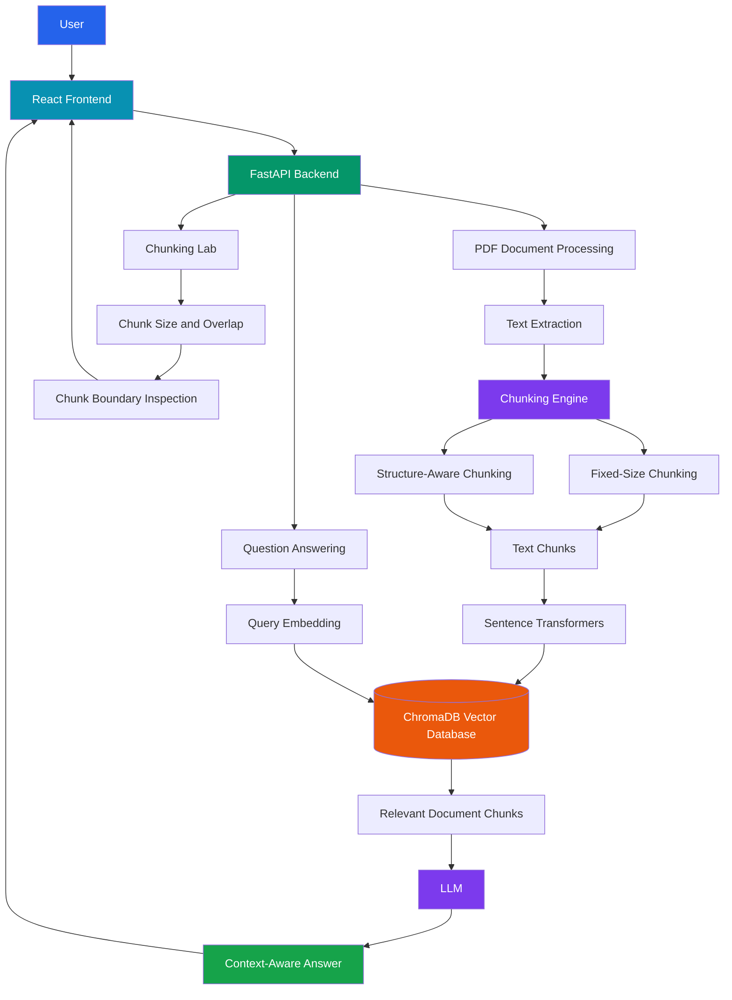
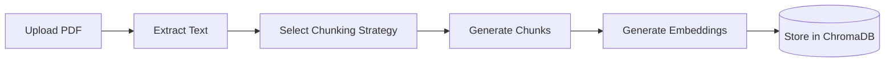
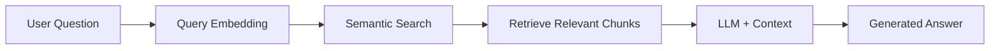
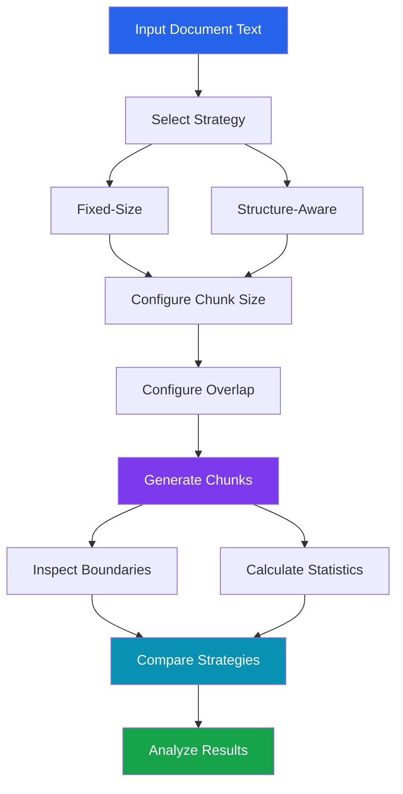

<div align="center">

# 🩺 MediRAG AI
### Intelligent Medical Document Assistant Using Retrieval-Augmented Generation


**An AI-powered medical document analysis and question-answering system built with Retrieval-Augmented Generation (RAG), semantic search, vector embeddings, and intelligent text chunking.**

</div>

---

## 📖 Project Overview

**MediRAG AI** is an intelligent medical document assistant that uses Retrieval-Augmented Generation (RAG) to extract, process, retrieve, and analyze information from medical PDF documents.

The system combines Large Language Models (LLMs), vector databases, and semantic search to generate context-aware answers grounded in uploaded documents.

It also provides a **Chunking Lab** to explore how different text chunking strategies and overlap configurations affect document segmentation.

### 🎯 Project Objectives

- Develop an intelligent RAG-based document assistant.
- Extract and process medical PDF documents.
- Implement semantic search using vector embeddings.
- Store and retrieve document chunks using ChromaDB.
- Integrate LLMs for context-aware question answering.
- Implement fixed-size and structure-aware chunking.
- Experiment with chunk size and overlap.
- Visualize and compare chunk boundaries.
- Build a full-stack AI application using React and FastAPI.

---

## ✨ Key Features

| Feature | Description |
|---------|-------------|
| 📄 PDF Processing | Extracts text from uploaded medical PDF documents |
| 🧠 RAG Pipeline | Combines document retrieval with LLM-generated answers |
| 🔎 Semantic Search | Retrieves relevant document content using embeddings |
| 🗄️ Vector Database | Stores document embeddings in ChromaDB |
| 🤖 AI Question Answering | Generates answers using retrieved context |
| ✂️ Fixed-Size Chunking | Splits text using configurable character limits |
| 📝 Structure-Aware Chunking | Splits text at headings, paragraphs, and sentence boundaries |
| 🔁 Chunk Overlap | Preserves contextual continuity between chunks |
| 🧪 Chunking Lab | Allows experimentation with different chunk configurations |
| 📊 Chunk Comparison | Displays chunk counts, sizes, and boundaries |
| 🌐 Web Interface | React-based frontend |
| ⚡ REST API | FastAPI-powered backend |

---

## 🏗️ System Architecture



---

## 🔄 Retrieval-Augmented Generation Workflow

MediRAG AI uses two major processes: document indexing and question answering.

### 1. Document Indexing



### 2. Question Answering



### How RAG Works

1. The user uploads a medical PDF.
2. The backend extracts text from the document.
3. The text is divided into smaller chunks.
4. Sentence Transformers convert chunks into vector embeddings.
5. ChromaDB stores the embeddings.
6. The user asks a question.
7. The system converts the question into an embedding.
8. Semantic search retrieves relevant document chunks.
9. The retrieved context is provided to the LLM.
10. The LLM generates a contextual response.

---

# ✂️ Chunking Strategies

## Fixed-Size vs. Structure-Aware Chunking and the Role of Overlap

One of the main learning objectives of this project is to explore different document chunking techniques and understand how chunk size, overlap, and text structure affect segmentation.

## 1. Fixed-Size Chunking

Fixed-size chunking divides text into smaller segments based on a predefined number of characters.

### Example

Input:

```text
Artificial Intelligence is transforming healthcare.
Machine Learning helps analyze medical information.
RAG systems retrieve relevant knowledge from documents.
```

Example configuration:

```python
chunk_size = 50
chunk_overlap = 10
```

The text is divided into chunks of up to 50 characters, with up to 10 characters repeated between consecutive chunks.

### Advantages

- Simple to implement.
- Computationally efficient.
- Predictable chunk sizes.
- Easy to configure and experiment with.

### Limitations

- May split sentences in the middle.
- May separate related information.
- Does not consider semantic meaning.

---

## 2. Structure-Aware Chunking

Structure-aware chunking attempts to preserve the natural organization of text.

It considers:

- Section headings
- Paragraph boundaries
- Sentence boundaries
- Document structure

### Example

Input:

```text
# Introduction
Artificial Intelligence is transforming healthcare.

# Machine Learning
Machine Learning helps analyze medical information.

# Retrieval-Augmented Generation
RAG combines information retrieval with language models.
```

Expected structure-aware segmentation:

```text
Chunk 1:
Introduction
Artificial Intelligence is transforming healthcare.

Chunk 2:
Machine Learning
Machine Learning helps analyze medical information.

Chunk 3:
Retrieval-Augmented Generation
RAG combines information retrieval with language models.
```

### Advantages

- Preserves document structure.
- Reduces unnecessary sentence splitting.
- Improves chunk readability.
- Keeps related content together where possible.

### Limitations

- Produces variable chunk sizes.
- Depends on document formatting.
- Large sections may still require splitting.
- Does not necessarily use embedding-based semantic similarity.

---

## 3. Role of Chunk Overlap

Chunk overlap repeats a portion of text between consecutive chunks.

It helps preserve information near chunk boundaries.

### Example

```text
Original Text:
ABCDEFGHIJKLMNO

Chunk Size: 6
Overlap: 2

Chunk 1: ABCDEF
Chunk 2: EFGHIJ
Chunk 3: IJKLMN
Chunk 4: MNO
```

### Why Overlap Matters

Without overlap, important information may be separated across chunk boundaries.

With overlap, neighboring chunks share some context.

However, excessive overlap can:

- Increase the number of chunks.
- Increase embedding computation.
- Increase vector storage requirements.
- Introduce redundant retrieval results.

---

## 🧪 Chunking Lab

The Chunking Lab provides an experimental interface for testing different chunking configurations.

### Available Experiments

- Select a chunking strategy.
- Adjust chunk size.
- Configure overlap.
- Inspect individual text chunks.
- Compare chunk boundaries.
- Observe the number of generated chunks.
- Analyze average chunk length.
- Compare different chunking configurations.

### Experiment Configurations

| Experiment | Strategy | Chunk Size | Overlap |
|------------|----------|------------|---------|
| 1 | Fixed-Size | 200 | 0 |
| 2 | Fixed-Size | 200 | 50 |
| 3 | Fixed-Size | 500 | 50 |
| 4 | Fixed-Size | 500 | 100 |
| 5 | Structure-Aware | 500 | 50 |
| 6 | Structure-Aware | 1000 | 100 |

*These are suggested experiment configurations, not measured results.*

### Chunking Experiment Workflow



---

## 📊 Fixed-Size vs. Structure-Aware Comparison

| Parameter | Fixed-Size | Structure-Aware |
|-----------|------------|-----------------|
| Splitting Method | Character count | Natural text boundaries |
| Chunk Length | More predictable | Variable |
| Sentence Preservation | Not guaranteed | Preferred |
| Heading Awareness | No | Yes |
| Paragraph Preservation | Not guaranteed | Preferred |
| Implementation | Simple | More complex |
| Context Preservation | Depends on overlap | Depends on structure and overlap |
| Best Use Case | Uniform segmentation | Structured documents |

**Note:** Retrieval accuracy cannot be determined from chunk count alone. It requires evaluation using representative questions and relevant reference answers.

---

## 🛠️ Technology Stack

### Frontend

- React.js
- JavaScript
- CSS
- Vite

### Backend

- Python
- FastAPI
- Uvicorn

### Artificial Intelligence

- Retrieval-Augmented Generation
- Large Language Models
- Sentence Transformers
- Vector Embeddings
- Semantic Search

### Vector Database

- ChromaDB

### Document Processing

- PDF Text Extraction
- Fixed-Size Chunking
- Structure-Aware Chunking
- Overlap-Based Chunking

---

## 📁 Project Structure

```text
MediRAG_AI_v2/
│
├── backend/
│   ├── app/
│   │   ├── main.py
│   │   ├── rag.py
│   │   │
│   │   └── services/
│   │       └── chunking.py
│   │
│   ├── tests/
│   │   └── test_chunking.py
│   │
│   └── requirements.txt
│
├── frontend/
│   ├── src/
│   │   ├── main.jsx
│   │   ├── ChunkingLab.jsx
│   │   └── style.css
│   │
│   ├── package.json
│   └── ...
│
├── README.md
└── ...
```

---

## 🚀 Installation and Setup

### Prerequisites

Ensure the following tools are installed:

- Python
- Node.js and npm
- Git
- A suitable LLM API configuration

### Step 1: Clone Repository

```bash
git clone https://github.com/YOUR_USERNAME/MediRAG-AI-Intelligent-Document-Assistant.git

cd MediRAG-AI-Intelligent-Document-Assistant
```

Replace `YOUR_USERNAME` with your GitHub username.

### Step 2: Backend Setup

Navigate to the backend directory:

```bash
cd backend
```

Create a virtual environment:

```bash
python -m venv .venv
```

Activate the environment on Windows:

```powershell
.\.venv\Scripts\Activate.ps1
```

Install dependencies:

```bash
pip install -r requirements.txt
```

### Step 3: Configure Environment Variables

Create or configure the `.env` file according to your backend's required settings.

Keep API keys and other secrets private.

**Never commit your real `.env` file to GitHub.**

### Step 4: Run Backend

```bash
uvicorn app.main:app --reload
```

Backend URL:

```text
http://127.0.0.1:8000
```

FastAPI documentation:

```text
http://127.0.0.1:8000/docs
```

### Step 5: Frontend Setup

Open another terminal.

Navigate to the frontend directory:

```bash
cd frontend
```

Install dependencies:

```bash
npm install
```

Start the frontend:

```bash
npm run dev
```

Open the local URL displayed in the terminal.

Usually:

```text
http://localhost:5173
```

---

## 🧪 Testing

Run the chunking unit tests from the backend directory:

```bash
python -m pytest tests/test_chunking.py
```

The tests should cover:

- Fixed-size chunk generation.
- Overlap behavior.
- Structure-aware splitting.
- Chunk configuration validation.

---

## 🔐 Security Considerations

- Keep API keys in environment variables.
- Exclude `.env` files from version control.
- Avoid uploading confidential patient information.
- Validate uploaded document types.
- Use appropriate access controls for sensitive data.
- Review AI-generated answers before relying on them.

---

## 📚 Learning Outcomes

This project demonstrates practical experience in:

1. Designing Retrieval-Augmented Generation pipelines.
2. Integrating LLMs into full-stack applications.
3. Building semantic search systems.
4. Working with vector embeddings and ChromaDB.
5. Implementing configurable text chunking.
6. Comparing fixed-size and structure-aware strategies.
7. Understanding chunk overlap and context preservation.
8. Developing REST APIs using FastAPI.
9. Building frontend interfaces using React.
10. Experimenting with AI document processing techniques.

---

## 🔮 Future Enhancements

- Token-based chunking.
- Embedding-based semantic chunking.
- Hybrid keyword and vector retrieval.
- Retrieval precision and recall evaluation.
- Automated chunking strategy benchmarking.
- Document source citations.
- Support for DOCX and additional file formats.
- Advanced medical terminology processing.
- Improved response verification.
- Multi-document question answering.


