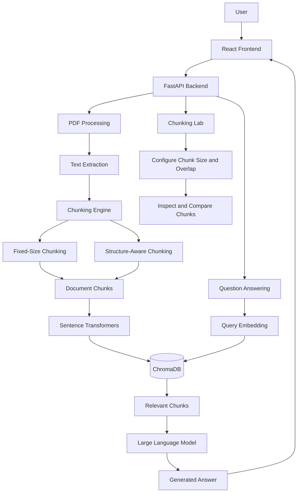
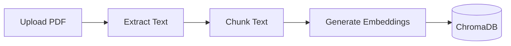
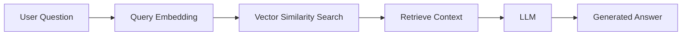
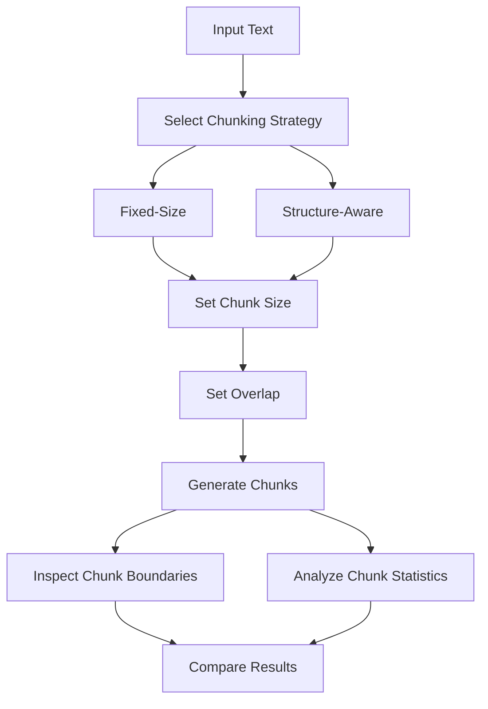

# MediRAG AI  Intelligent Medical Document Assistant

<div align="center">

### Retrieval-Augmented Generation for Medical Document Analysis


**An AI-powered medical document assistant using Retrieval-Augmented Generation (RAG), semantic search, vector embeddings, and configurable text chunking strategies.**

</div>


## Project Overview

MediRAG AI is a full-stack Retrieval-Augmented Generation application designed to extract, process, and analyze information from medical PDF documents.

The system combines Large Language Models, Sentence Transformers, and ChromaDB to retrieve relevant information and generate context-aware answers.

The project also includes a Chunking Lab for comparing fixed-size and structure-aware text chunking strategies.

## Key Features

- Medical PDF document upload and text extraction
- Retrieval-Augmented Generation pipeline
- Semantic search using vector embeddings
- ChromaDB vector storage
- LLM-based question answering
- Configurable fixed-size chunking
- Structure-aware chunking
- Customizable chunk size and overlap
- Chunk boundary inspection
- Chunking strategy comparison
- React frontend and FastAPI backend


## System Architecture




## RAG Workflow

### Document Indexing



### Question Answering



### Working Process

1. The user uploads a medical PDF document.
2. The system extracts the document text.
3. Text is divided into chunks using the selected strategy.
4. Sentence Transformers generate embeddings.
5. Embeddings are stored in ChromaDB.
6. The user submits a question.
7. Relevant document chunks are retrieved.
8. The LLM generates an answer using retrieved context.


## Chunking Strategies

### 1. Fixed-Size Chunking

Fixed-size chunking divides text into smaller segments using a predefined character limit.

Example configuration:

```python
chunk_size = 500
chunk_overlap = 100
```

Advantages:

- Simple implementation
- Predictable chunk sizes
- Efficient text processing
- Configurable overlap

Limitations:

- May split sentences
- May separate related information
- Does not consider document structure

### 2. Structure-Aware Chunking

Structure-aware chunking attempts to preserve natural document boundaries.

It considers:

- Section headings
- Paragraph boundaries
- Sentence boundaries

Example:

```text
Original Document:

Introduction
Artificial Intelligence is transforming healthcare.

Machine Learning
Machine Learning helps analyze medical information.
```

Result:

```text
Chunk 1:
Introduction
Artificial Intelligence is transforming healthcare.

Chunk 2:
Machine Learning
Machine Learning helps analyze medical information.
```

### 3. Role of Overlap

Chunk overlap repeats a portion of text between consecutive chunks to preserve contextual continuity.

Example:

```text
Original Text:
ABCDEFGHIJKLMNO

Chunk Size: 6
Overlap: 2

Chunk 1: ABCDEF
Chunk 2: EFGHIJ
Chunk 3: IJKLMN
Chunk 4: MNO
```

Overlap can improve continuity but may increase storage requirements and retrieval redundancy.


## Chunking Lab

The Chunking Lab allows users to experiment with text segmentation.

Available functionality:

- Select chunking strategy
- Configure chunk size
- Configure chunk overlap
- Generate text chunks
- Inspect chunk boundaries
- Compare chunk counts
- Analyze average chunk length

### Chunking Experiment Workflow



### Suggested Experiments

| Experiment | Strategy | Chunk Size | Overlap |
|---|---|---:|---:|
| 1 | Fixed-Size | 200 | 0 |
| 2 | Fixed-Size | 200 | 50 |
| 3 | Fixed-Size | 500 | 50 |
| 4 | Fixed-Size | 500 | 100 |
| 5 | Structure-Aware | 500 | 50 |
| 6 | Structure-Aware | 1000 | 100 |

These configurations are suggested for experimentation and do not represent measured results.


## Chunking Strategy Comparison

| Feature | Fixed-Size | Structure-Aware |
|---|---|---|
| Splitting Method | Character count | Text boundaries |
| Chunk Size | More predictable | Variable |
| Sentence Preservation | Not guaranteed | Preferred |
| Heading Awareness | No | Yes |
| Paragraph Awareness | No | Yes |
| Complexity | Low | Moderate |
| Context Preservation | Depends on overlap | Depends on structure and overlap |


## Technology Stack

| Component | Technology |
|---|---|
| Frontend | React, JavaScript, CSS, Vite |
| Backend | Python, FastAPI |
| Language Model | LLM API |
| Embedding Model | Sentence Transformers |
| Vector Database | ChromaDB |
| Document Processing | PDF Text Extraction |
| Retrieval | Vector Similarity Search |
| Chunking | Fixed-Size and Structure-Aware |


## Project Structure

```text
MediRAG_AI_v2/
|
|-- backend/
|   |-- app/
|   |   |-- main.py
|   |   |-- rag.py
|   |   |
|   |   |-- services/
|   |       |-- chunking.py
|   |
|   |-- tests/
|   |   |-- test_chunking.py
|   |
|   |-- requirements.txt
|
|-- frontend/
|   |-- src/
|   |   |-- main.jsx
|   |   |-- ChunkingLab.jsx
|   |   |-- style.css
|   |
|   |-- package.json
|
|-- README.md
```


## Installation and Setup

### Prerequisites

- Python
- Node.js
- npm
- Git
- LLM API credentials

### Clone Repository

```bash
git clone https://github.com/YOUR_USERNAME/MediRAG-AI-Intelligent-Document-Assistant.git

cd MediRAG-AI-Intelligent-Document-Assistant
```

Replace `YOUR_USERNAME` with your GitHub username.

### Backend Setup

```bash
cd backend
python -m venv .venv
```

Activate the virtual environment on Windows:

```powershell
.\.venv\Scripts\Activate.ps1
```

Install dependencies:

```bash
pip install -r requirements.txt
```

Configure the required environment variables in a local `.env` file.

Start the backend:

```bash
uvicorn app.main:app --reload
```

Backend URL:

```text
http://127.0.0.1:8000
```

API documentation:

```text
http://127.0.0.1:8000/docs
```

### Frontend Setup

Open another terminal in the project root:

```bash
cd frontend
npm install
npm run dev
```

Open the local URL displayed by Vite, typically:

```text
http://localhost:5173
```

---

## Testing

Run chunking unit tests from the backend directory:

```bash
python -m pytest tests/test_chunking.py
```

The tests cover chunking behavior, overlap handling, and configuration validation.


## Learning Outcomes

This project demonstrates experience in:

- Retrieval-Augmented Generation
- Large Language Model integration
- Vector databases and semantic search
- Document embedding generation
- Fixed-size and structure-aware chunking
- Chunk size and overlap experimentation
- FastAPI backend development
- React frontend development
- Full-stack AI application architecture


## Future Enhancements

- Token-based chunking
- Embedding-based semantic chunking
- Hybrid search
- Retrieval quality evaluation
- Multi-document question answering
- Improved source citations
- Advanced medical terminology processing
- Support for additional document formats


## Security and Privacy

- Store API keys in environment variables.
- Exclude `.env` files from version control.
- Avoid uploading confidential patient information.
- Validate uploaded document types.
- Protect sensitive data with appropriate access controls.

